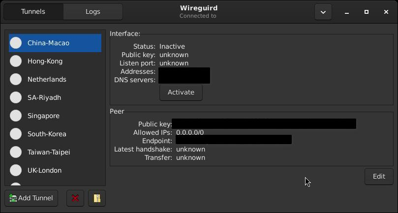
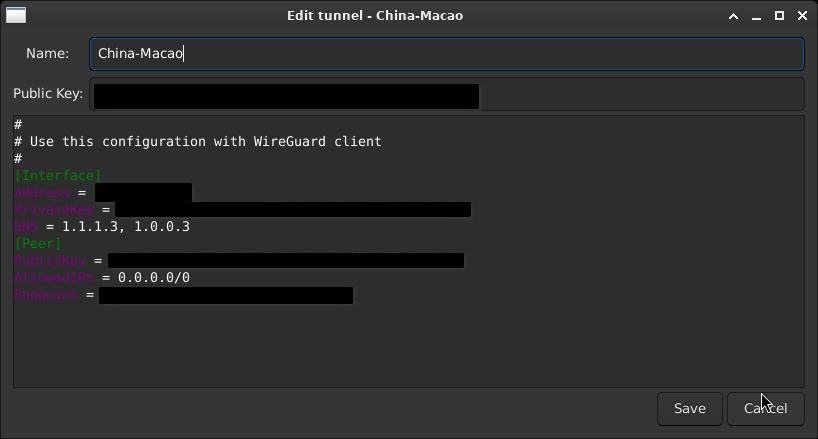

# WireGuird GUI for Void Linux

An `.xbps` package for [WireGuird](https://github.com/UnnoTed/wireguird), built from the official source code for Void Linux. 

WireGuird is a Linux GTK GUI client for WireGuard. It lists tunnels from `/etc/wireguard` and controls Wireguard through `wg-quick`.

## Screenshots

| Main Interface | Edit Tunnel |
| :---: | :---: |
|  |  |

## Package Details
* **Version:** 1.1.0
* **Tested Environment:** Void Linux with **Xfce** desktop environment (System tray/AppIndicator required).
* **Original Source:** [UnnoTed/wireguird](https://github.com/UnnoTed/wireguird)
* **License:** MIT

## Installation

1. Download the `.xbps` file from the [Releases](../../releases) page.
2. Install the package locally using the following command (replace the path with your actual download path):
   ```bash
   sudo xbps-install -R /path/to/downloaded/file wireguird

   ## Build from Source (Void Linux)

If you prefer to build the package yourself using `xbps-src`, follow these steps:

1. Clone the `void-packages` repository and set it up:
   ```bash
   git clone --depth 1 https://github.com/void-linux/void-packages.git
   cd void-packages
   ./xbps-src binary-bootstrap

   2. Create the package directory and add the template:
   mkdir -p srcpkgs/wireguird
